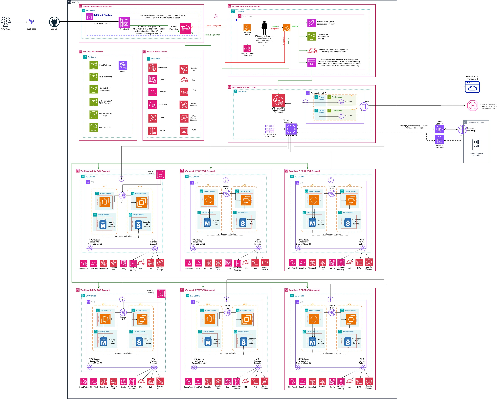
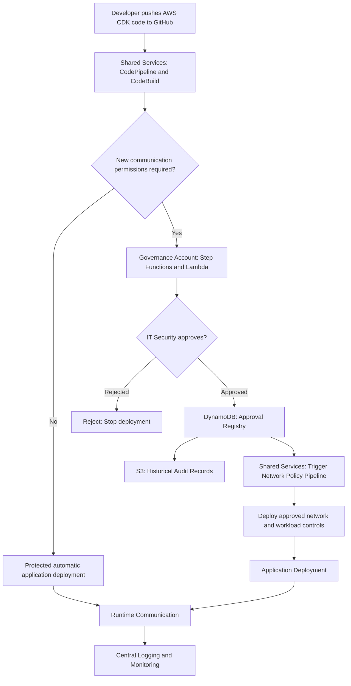

# AWS Network Communication Governance Platform

> **High-level architecture proposal** — a cloud equivalent of the client's TUFIN approval principles, without extending the existing on-premises TUFIN system.  
> **Scope:** Architecture and reasoning, not a production-ready implementation.  
> **Infrastructure as code:** AWS CDK with TypeScript · **Source control:** GitHub · **Reference Region:** `eu-central-1`.

## Contents

1. [Purpose and executive summary](#1-purpose-and-executive-summary)
2. [Background, requirements and scope](#2-background-requirements-and-scope)
3. [Architecture principles and trust boundaries](#3-architecture-principles-and-trust-boundaries)
4. [Architecture diagram and interpretation](#4-architecture-diagram-and-interpretation)
5. [AWS account model and responsibilities](#5-aws-account-model-and-responsibilities)
6. [AWS service inventory](#6-aws-service-inventory)
7. [Communication governance and CI/CD process](#7-communication-governance-and-cicd-process)
8. [Why DynamoDB and S3?](#8-why-dynamodb-and-s3)
9. [How the four scenarios are covered](#9-how-the-four-scenarios-are-covered)
10. [Security and further hardening](#10-security-and-further-hardening)
11. [Small code demonstration](#11-small-code-demonstration)
12. [AWS documentation and references](#12-aws-documentation-and-references)

---

## 1. Purpose and executive summary

The AWS platform serves independent workload teams. A team develops and maintains applications using **AWS CDK with TypeScript**, keeps source code in **GitHub**, and uses separate AWS accounts for development, test and production. The IT Security department needs to understand, approve, restrict and audit how these workloads communicate with other AWS workloads, AWS-managed services and external parties.

The existing on-premises process uses **TUFIN** requests describing source, destination, protocol and port. This architecture extends the **governance principles** of TUFIN into AWS, but does **not** attempt to install or extend TUFIN itself to the cloud.

The target solution is an **AWS Network Communication Governance Platform**, combining:

- **An approval/control plane:** developers declare required connectivity as code; IT Security approves a specific requested change; an approved communication registry tracks permissions and status.
- **A deployment plane:** an authorized central pipeline generates and deploys network, endpoint, identity and application access controls into the appropriate AWS accounts.
- **A traffic/data plane:** Amazon VPC, AWS Transit Gateway (TGW), AWS Network Firewall, Security Groups, API Gateway, VPC endpoints and IAM enforce connectivity in ways appropriate to each type of traffic.
- **An audit/assurance plane:** CloudTrail, Config, GuardDuty, Security Hub, VPC/TGW Flow Logs, Network Firewall logs, API logs and a protected S3 audit store support detection, evidence and compliance reporting.

**Fundamental rule:** a network route is *reachability*, not *authorization*. The security decision must be independently enforced using the appropriate AWS controls. Approval is not demonstrated merely by a green line on the diagram; it must be linked to the exact policy version deployed and an independently verifiable record.

**Security objective:** new, unapproved connectivity must not be enabled; approved connectivity must be minimally scoped, attributable to a workload and change request, monitored, reviewable, and revocable.

**Architecture status:** This document explains a **proposed** design based on the attached diagram. It is *not* evidence that the services, policies, controls or logging are already deployed. Several implementation-level decisions remain to be validated before production sign-off.

## 2. Background, requirements and scope

### 2.1 Business and engineering context

- Multiple workload teams own applications and their application-level infrastructure.
- Separate AWS accounts are maintained for development, test and production. The drawing represents **Workload A** and **Workload B**, each with DEV, TEST and PROD accounts.
- Workloads may use private VPC subnets, EC2/applications, internal ALBs/NLBs, relational databases, API Gateway, and AWS-managed services.
- GitHub repositories hold TypeScript CDK infrastructure definitions and proposed communication declarations.
- The Platform Team operates the AWS landing zone, shared network fabric, account guardrails and common deployment tooling.
- IT Security owns approval criteria and should be able to explain *why* each permitted communication exists.
- TUFIN continues to govern on-premises firewall changes where relevant; existing hybrid connectivity is shown for context but remains out of scope for this effort.

### 2.2 In-scope scenarios

| ID in this README | Requirement | Intended control pattern |
|---|---|---|
| **S1** | Private connectivity between different workload accounts (internal ALB, NLB, private API) | TGW + mandatory Network Firewall inspection for VPC-to-VPC traffic; Security Groups and app authorization; service-specific endpoint controls where needed |
| **S2** | A non-production workload calls another non-production workload's **public** API Gateway | Inspected central internet egress + destination API authorization, monitoring and protections |
| **S3** | Workloads access AWS services such as DynamoDB or S3 using platform-managed VPC endpoints, with IT Security approval | Local gateway/interface endpoints + endpoint policies + least-privilege IAM/resource permissions + audit |
| **S4** | Workloads call external internet/SaaS destinations, including identity providers | TGW + Network Firewall + egress VPC + NAT + IGW; destination approval and service authentication |

### 2.3 Out of scope

- Designing or changing on-premises TUFIN requests and on-prem firewall rules.
- Full Direct Connect/VPN hybrid-routing design, although existing links are depicted as background context.
- All application runtime security, software vulnerability remediation and database administration (these remain necessary but are managed by their respective teams).
- A working implementation of the governance portal, AWS CDK constructs, state machines or all route tables. Examples in this document are **design examples, not production-ready deployment scripts**.
- A multi-Region disaster-recovery architecture; the diagram is regional, and each additional Region requires a deliberate network/security design.

### 2.4 Success criteria

1. IT Security can list every **approved** source/destination/action/protocol/port by account, workload and stage.
2. Developers cannot self-authorize new communication via an alternate CDK stack, permissive Security Group, public IP, VPC peering, new NAT/IGW, endpoint or IAM policy.
3. Appropriate AWS controls actually **block** unapproved communication.
4. A requested permission is traceable through **request → identity-verified approval → exact artifact/policy → deployment → observed access**.
5. Changes, expiry, revocation, drift and emergency exceptions are managed consistently.

## 3. Architecture principles and trust boundaries

1. **Explicit intent:** communication is declared as structured data, not inferred from a developer's broad network permissions.
2. **Default deny:** absent valid approval, neither connectivity nor access should be granted. Any essential bootstrap exceptions are documented, tightly scoped and pre-approved.
3. **Separate duties:** IT Security approves; Platform Engineering administers and deploys the shared controls; workload teams own their business applications and request connectivity.
4. **Immutable approval binding:** approve a specific request revision and generated policy diff, not an open-ended ability for a branch or pipeline to deploy whatever it wants later.
5. **Layered enforcement:** TGW + Network Firewall for routed L3/L4 flows, Security Groups at resources, IAM/resource/endpoint policies for AWS APIs, and app-level identity/authorization for APIs.
6. **No bypass:** prevent unauthorized routing, direct egress, public exposure, peering/PrivateLink/Lattice bypasses and service-level API calls that bypass intended inspection.
7. **Environment isolation:** DEV/TEST-to-PROD is denied by default; separate account IDs and route domains/policies are used.
8. **Central evidence, independent verification:** approval records, deployed configuration and observed usage are different data sets and must be reconciled.
9. **Highly available regional routing:** multi-AZ NAT/attachment paths, monitored routes, tested recovery and service-specific availability considerations.
10. **Controlled exceptions:** break-glass permissions are time-bounded, narrowly scoped, reviewed and fully audited.

### 3.1 Four trust boundaries

| Boundary | Trust being crossed | Required checks |
|---|---|---|
| GitHub → Shared Services CI/CD | Untrusted proposed code becomes deployable artifact | Repository trust, branch protection, dependency/code checks, synthesis, artifact digest |
| Shared Services → Governance | Technical change becomes a security decision | Authenticated request, normalized intent, approver authorization, exact change binding |
| Shared Services → Network/Workload accounts | Pipeline modifies protected AWS resources | Cross-account assume-role trust, restrictive CloudFormation roles, policy verification, least privilege |
| Workload traffic → another service | Application attempts actual access | Route through approved inspection point *or* service-specific enforcement, authentication, authorizations, monitoring |

## 4. Architecture diagram and interpretation



**Figure:** This README accompanies the sketch; it does not silently redefine what is drawn. Any items described as *recommended additions* below are recommendations for LLD refinement, not claims that the drawing already implements them.

### 4.1 Logical layers

```text
              DEVELOPER / GITHUB
                     |
                     v
        SHARED SERVICES: CodePipeline
          CodeBuild + CDK validation
                     |
          New / broader communication?
               /              \
             NO               YES
             |                  |
             v                  v
    Protected app         GOVERNANCE ACCOUNT
      deployment          Validate + human review
             |                  |
             |            Approved? -- No --> STOP
             |                  |
             |                 Yes
             |                  |
             |          DynamoDB registry + S3 audit
             |                  |
             |                  v
             |          SHARED SERVICES: Protected
             |            Network Policy Pipeline
             |                  |
             |          Cross-account deployment
             |                  |
             |          NETWORK / WORKLOAD CONTROLS
             |          Deploy + verify approved rules
             |                  |
             |          Release application deployment
             |                  |
             +------------------+
                      |
                      v
              APPLICATION RUNTIME
        S1 / S2 / S4: inspected TGW + egress paths
        S3: approved VPC endpoints + IAM policies
                      |
                      v
              LOGGING / ASSURANCE
```

### 4.2 Control plane is not the data plane

- **Governance components** (Step Functions, Lambda, DynamoDB, S3) do **not** forward packets.
- **Network components** (TGW, firewall, NAT) do **not** decide who is an authorized human approver.
- **AWS API permissions** (IAM, service policies) cannot be reduced to an IP/port firewall rule.
- **Logging controls** do not enforce policy by themselves.

## 5. AWS account model and responsibilities

> Account boundaries in the drawing are logical ownership domains. Some services, including IAM roles, GuardDuty configurations and CloudTrail/Config delivery settings, operate across accounts. The management account and organizational root/OU policy hierarchy also exist above the depicted account boxes.

| Account | Primary owner | Proposed responsibilities and services | Must not be allowed |
|---|---|---|---|
| **Shared Services** | Platform Engineering | CodePipeline; CodeBuild; GitHub source connection; CDK synthesis; central application and network policy deployment pipelines; encrypted artifact buckets and keys | Unconditionally deploy arbitrary protected networking changes |
| **Governance** | IT Security | Step Functions approval state machine; Lambda validation and decision handlers; EventBridge (if event-driven); DynamoDB communication registry; operational approval artifacts; reviewer notifications | Broad, standing administrator access to workload and network accounts |
| **Network** | Network / Platform Team | TGW; TGW route tables; RAM sharing; native Network Firewall network-function attachment; egress VPC; NAT/IGW; regional routing and shared DNS components | Unauthorized workload-owned changes to central policies and routes |
| **Security** | IT Security / Operations | Organization-wide delegated administration as appropriate; Security Hub, GuardDuty, AWS Config aggregation, selected security findings and standards, Firewall Manager if adopted | Single-handed ability to self-approve and silently deploy new communications |
| **Logging** | IT Security / Audit | Central S3 logs; CloudTrail; VPC and TGW Flow Logs; firewall and load balancer/API logs; Athena catalog/queries; immutable audit record copy | Routine workload admin deletion or modification of retained evidence |
| **Workload-A DEV/TEST/PROD** | Workload A team | App VPC/subnets, application compute, internal NLB/ALB where applicable, databases, endpoints, workload IAM/SGs; environment-specific TGW attachments | Direct modifications to protected central routing and firewall rules |
| **Workload-B DEV/TEST/PROD** | Workload B team | Same as A; public API Gateway hosted at *account/Regional level*, not physically in a subnet; private API Gateway where needed | Granting unrestricted cross-account access outside approval |

**Deployment note:** Some IAM, KMS, Secrets Manager, GuardDuty or CloudWatch icons placed at the account boundary in a diagram are representative. IAM is an account-level service; resources such as KMS keys, AWS Config recorders, endpoints, Security Groups and CloudWatch logs exist or are configured in the respective accounts/Regions as needed.

**Infrastructure-as-code note:** The client requirement is **AWS CDK/TypeScript**. If a Terraform icon still appears in the diagram, treat it as a drawing artifact until the client explicitly approves Terraform as an additional tool.

## 6. AWS service inventory

### 6.1 Governance and delivery

| AWS component | Role in the solution | Minimum security expectations |
|---|---|---|
| **CodePipeline** | Release/approval orchestration in Shared Services | Protected pipeline configuration; constrained service role; authenticated source; encrypted artifacts |
| **CodeBuild** | Build/test/CDK synth, communication schema validation, security diff | Ephemeral build, pinned dependencies, no blanket permission to modify network resources |
| **CloudFormation** | Deploy approved CDK-synthesized stacks | Dedicated execution roles with restricted policies, stack change controls |
| **Step Functions (Standard)** | Coordinate optional independent, long-running security approval | Authenticated callback, timeout/expiry, least-privilege integration roles |
| **Lambda** | Normalize requests, verify decisions, write registry/audit events, trigger pipelines | Minimal IAM, input validation, idempotency, no generic admin deployment role |
| **EventBridge** | Route *verified* request/approval/deployment events | Restrictive bus policies, event-source validation, audit and retry/DLQ strategy |
| **DynamoDB** | Current permission and approval state | Encryption, backups/PITR, conditional writes, access isolation |
| **S3** | Append-only evidence and historical artifacts | SSE-KMS, versioning, Object Lock where required, retention and restricted access |
| **AWS IAM / Identity Center** | Authenticate developers, approvers and deployment roles | Separate identities, MFA, least privilege, short sessions, approval role segregation |

### 6.2 Networking and runtime enforcement

| Component | Responsibilities | Important limitation |
|---|---|---|
| **VPC + subnets + route tables** | Isolate workloads and steer traffic | A route to TGW does not restrict destination port or business service |
| **Transit Gateway** | Regional private routing across VPCs/accounts | Layer-3 router, **not a firewall**; inspection must be deliberately routed |
| **Native Network Firewall TGW attachment** | Centrally inspect routed east-west and north-south traffic | Only traffic actually steered through attachment is inspected; service endpoint flows may bypass |
| **Network Firewall rule groups/policies** | Stateful tuple, domain and protocol filtering | FQDN/TLS visibility is not equivalent to full application identity |
| **NAT Gateways** | Source NAT for controlled outbound IPv4 egress | NAT is not an authorization engine; costs/throughput/AZ routes require sizing |
| **Internet Gateway** | Internet path for the Egress VPC | Must not be a direct bypass from workload VPCs |
| **VPC Gateway Endpoints** | S3/DynamoDB in-VPC access | Cannot be consumed through TGW from another VPC |
| **VPC Interface Endpoints** | Private access to supported AWS APIs and `execute-api` | Endpoint DNS, SG, endpoint policy and resource-policy choices matter |
| **Internal ALB/NLB** | Private entry point to apps in destination workload VPC | Must have restrictive listener/backend policies and application auth |
| **API Gateway** | Public or private managed API front door | An API Gateway public endpoint belongs to an AWS account/Region, not a VPC subnet |
| **Route 53 Resolver / DNS Firewall** | Private DNS and DNS request policy where adopted | DNS filtering does not block direct-IP or all TLS traffic |

## 7. Communication Governance and CI/CD Process

### 7.1 Deployment Pipelines

The architecture uses two deployment pipelines in the **Shared Services Account**:

1. **Workload Infrastructure Pipeline:** Deploys application and infrastructure changes that do not require new or expanded network communication permissions.
2. **Network Policy Pipeline:** Deploys IT Security-approved changes, such as AWS Network Firewall rules, Security Group rules, IAM permissions, and VPC endpoint policies.

This separation allows developers to deploy routine application changes without requesting security approval every time, while ensuring that new communication permissions are reviewed before they are enabled.

### 7.2 End-to-End Communication Approval Workflow





**Step 1 — Developer submits changes**

A developer pushes AWS CDK code to GitHub, including any new communication requirements such as the source, destination, protocol, and port.

**Step 2 — CI/CD validates the changes**

AWS CodePipeline triggers CodeBuild stage in the **Workload Infrastructure Pipeline** to validate the code and check whether new or expanded communication permissions are required.

- **No new permissions:** The application can be deployed automatically, provided the change passes the required security checks.
- **New permissions required:** The request is forwarded to the Governance Account for IT Security approval.

**Step 3 — IT Security reviews the request**

The Governance Account uses AWS Step Functions and Lambda to coordinate the approval process. IT Security reviews the requested communication and manually approves or rejects it. If approved, continue to Step 4, else the deployment is rejected.

**Step 4 — Store the approval decision**

- **Amazon DynamoDB** stores the communication request and its approval status.
- **Amazon S3** stores historical audit records, including who approved or rejected the request and when.

Rejected requests are not deployed.

**Step 5 — Deploy approved network changes**

After approval, the Governance Account triggers the **Network Policy Pipeline** in Shared Services. Using restricted cross-account IAM roles, the pipeline deploys approved changes to the Network and relevant Workload Accounts.

Depending on the scenario, these changes may include:

- AWS Network Firewall rules
- Security Group rules
- IAM and VPC endpoint policies
- Transit Gateway routing changes, where necessary

**Step 6 — Monitor and audit communication**

Once the approved controls are deployed, the **Workload Infrastructure Pipeline** can continue its deployment actions. Now, the deployed applications can communicate through their permitted network paths. AWS CloudTrail, VPC Flow Logs, and Network Firewall logs provide visibility into configuration changes and network activity. Relevant logs are collected centrally for security monitoring and auditing.

### 7.3 Security Considerations

The approval process is supported by the following controls:

- **Least-privilege IAM:** Developers cannot directly modify protected network and security configurations.
- **Approval enforcement:** New or expanded communication permissions require IT Security approval before deployment.
- **Controlled deployment:** Only authorized CI/CD pipelines can deploy protected communication changes.
- **Auditability:** Security approvals and deployed changes are recorded for future review.
- **Default-deny:** Communication not explicitly permitted by the relevant security controls is blocked.

This provides a TUFIN-like approach to managing AWS communication while allowing application teams to continue deploying through GitHub and AWS CDK.

---

## 8. Why DynamoDB and S3?

The approval process needs to answer two different questions:

| Service | Purpose | Example |
|---|---|---|
| **DynamoDB** | Stores the **current** approval state (request ID, workload, destination, status, expiry, approved artifact) for quick lookups by pipelines. | “Is Workload-A-PROD approved to call Workload-B-PROD on TCP/443?” |
| **S3** | Retains **historical evidence** of requests, decisions and deployed changes, including prior versions. | “Who approved this rule and what changed afterward?” |

DynamoDB is the operational registry; S3 is the audit history. For a lightweight exercise, these could be simulated with files. In production, protect the audit archive using appropriate access controls, encryption, retention and immutability where required. These services do **not** enforce application traffic themselves.

## 9. How the four scenarios are covered

The same process applies to every scenario: a team declares an intended communication, IT Security approves a new or broadened permission, and a protected pipeline deploys the **appropriate** AWS control. The network path depends on the destination.

### S1 — Private communication between workload accounts

**Example 1:** Workload-A-PROD calls an internal API on Workload-B-PROD, exposed via an internal ALB or NLB.

```text
Workload A VPC -> Transit Gateway -> AWS Network Firewall -> Transit Gateway -> Workload B VPC -> internal ALB/NLB
```

**Example 2:** Workload-A-PROD calls an internal API on Workload-B-PROD, exposed via a Private Amazon API Gateway REST API

```text
Workload A VPC -> Transit Gateway -> AWS Network Firewall -> Transit Gateway -> Workload B VPC -> Interface VPC Endpoint (execute-api) -> Private API Gateway (Account B)
```

- **Approval:** source workload/account, destination service/account, protocol, port and justification.
- **Enforcement:** TGW route segmentation, mandatory firewall inspection for routed VPC-to-VPC traffic, destination Security Groups, and application authentication.
- **Important distinction:** TGW provides routing, not authorization. The TGW route tables must deliberately steer both directions of the flow through the native firewall attachment.
- **Private API Gateway:** a private **REST** API uses an `execute-api` interface VPC endpoint and API resource/endpoint policies; this may be a separate private-access path rather than traffic routed through TGW. 
- **Shared Endpoint VPC:** From Workload A accounts, we can directly call an API in Workload B account by using 'AWS PrivateLink Connectivity + execute-api Interface VPC Endpoint'. But this traffic does not traverse Transit Gateway or your central Network Firewall. Our requirement is to have a centralized inspection approach. Therefore, we can create an 'execute-api' Interface VPC Endpoint within each VPC, or optionally, we can also create a Shared Endpoint VPC in the Network account. This VPC can host all of the 'AWS PrivateLink Connectivity + execute-api Interface VPC Endpoints' that we need. However, for this architecture, I am making use of the existing Interface VPC Endpoints in each account, to call the respective Private API using 'execute-api' endpoint. The traffic flowing from Interface VPC Endpoint to API Gateway uses AWS PrivateLink, not another TGW hop.

***Note: For diagram simplicity, only a single Interface VPC Endpoint and single Gateway VPC Endpoint is depicted per VPC. In a production environment, privately accessing multiple AWS services (such as Amazon SNS, Amazon SQS, AWS Lambda, and Amazon API Gateway) requires provisioning a dedicated Interface VPC Endpoint for each individual service. The same is true for privately accessing S3 and DynamoDB using Gateway VPC Endpoints. Both services require separate Gateway VPC Endpoints (one for Amazon S3 and another for Amazon DynamoDB). They are represented here as a single component solely to keep the architecture diagram clean and readable.***

### S2 — Non-production access to a public API Gateway

**Example:** Workload-A-DEV calls the public API of Workload-B-DEV.

```text
Workload A private subnet -> Transit Gateway -> Network Firewall -> Egress VPC -> NAT Gateway -> Internet Gateway -> Internet-facing API Gateway in Workload B's DEV account
```

- **Approval:** specific external API destination, consumer workload, environment and allowed protocol/port.
- **Enforcement:** centralized inspected egress **plus** API Gateway authentication/authorization; apply WAF and resource policies where appropriate.
- **Important distinction:** the public API Gateway is a Regional AWS service in the destination **account**, not a component inside the workload VPC. A firewall hostname rule alone does not authorize a specific API method or stage.

### S3 — Access to AWS services through VPC endpoints

**Example:** Workload-A accesses an approved S3 bucket or DynamoDB table.

```text
Workload VPC -> local S3/DynamoDB Gateway VPC endpoint -> AWS service
```

- **Approval:** workload IAM principal, AWS service, **resource ARN** and permitted actions—not merely TCP/443.
- **Enforcement:** platform-managed endpoint policies, least-privilege IAM, and resource policies where available.
- **Important distinction:** S3 and DynamoDB **gateway** endpoints belong to the consuming VPC; traffic through these endpoints does **not** traverse TGW or the central firewall. Interface endpoints are a separate pattern for supported services.

### S4 — Access to the internet / SaaS partners

**Example:** A workload calls an external identity provider's token endpoint.

```text
Workload private subnet -> Transit Gateway -> Network Firewall -> Transit Gateway -> Egress VPC -> NAT Gateway -> Internet Gateway -> SaaS provider
```

- **Approval:** source workload, destination FQDN/IP as appropriate, protocol/port, reason and duration.
- **Enforcement:** default-deny AWS Network Firewall policies, controlled TGW/VPC routes, approved DNS controls where appropriate, and service-level authentication.
- **Important distinction:** NAT is **not** a firewall; approved HTTPS destinations require careful domain/IP handling. Browser redirects to an identity provider do not originate from the workload VPC and are outside this backend egress path.

## 10. Security and further hardening

The design is secure **only if the approval boundary is enforceable**. A developer must not be able to bypass the workflow through a different CDK stack, public route, Security Group or IAM change.

| Security goal | Proposed control |
|---|---|
| **Prevent unapproved access** | Default-deny firewall rules and least-privilege IAM, endpoint and API policies. |
| **Prevent bypass routes** | Centrally owned TGW/firewall/egress configuration; AWS Organizations SCPs and scoped deployment permissions. |
| **Separate duties** | Workload teams request; IT Security approves; protected Shared Services pipelines deploy through dedicated cross-account roles. |
| **Prevent approval substitution** | Tie the approved request to the **exact change/artifact digest**; revalidate before deployment. |
| **Limit environment blast radius** | Separate DEV/TEST/PROD accounts, TGW route domains and security policies; deny non-prod → prod by default. |
| **Verify and investigate** | CloudTrail, AWS Config, TGW/VPC Flow Logs, Network Firewall logs, API/service access events, protected S3 history. |

**Further hardening, if this moves beyond a proof of concept:** implement rule expiry/revocation, automatic detection of drift between *approved* and *deployed* permissions, tested fail-closed routing, highly available egress, and stronger identity-aware controls or an explicit egress proxy for high-risk SaaS access. These are recommendations—not capabilities demonstrated by this exercise.

**Security caveats:** A central Network Firewall only inspects traffic actually routed through it. Gateway endpoint traffic and some AWS-managed service-to-service paths bypass TGW; they need IAM, endpoint or resource-level controls. TLS domain filtering alone is not equivalent to application authorization.

## 11. AWS documentation and references

The key AWS documentation behind the architecture:

- [AWS Transit Gateway: How it works](https://docs.aws.amazon.com/vpc/latest/tgw/how-transit-gateways-work.html)
- [Transit Gateway Network Firewall attachment](https://docs.aws.amazon.com/vpc/latest/tgw/tgw-nf-fw.html)
- [AWS Network Firewall Best Practices](https://aws.github.io/aws-security-services-best-practices/guides/network-firewall/deployment-architecture/docs/)
- [Routing traffic through a network function attachment](https://docs.aws.amazon.com/vpc/latest/tgw/route-traffic-nf-attachment.html)
- [AWS Network Firewall domain rule groups](https://docs.aws.amazon.com/network-firewall/latest/developerguide/stateful-rule-groups-domain-names.html)
- [S3 gateway endpoints](https://docs.aws.amazon.com/vpc/latest/privatelink/vpc-endpoints-s3.html)
- [DynamoDB gateway endpoints](https://docs.aws.amazon.com/vpc/latest/privatelink/vpc-endpoints-ddb.html)
- [API Gateway private REST APIs](https://docs.aws.amazon.com/apigateway/latest/developerguide/apigateway-private-apis.html)
- [API Gateway resource policies](https://docs.aws.amazon.com/apigateway/latest/developerguide/apigateway-resource-policies.html)
- [CodePipeline manual approvals](https://docs.aws.amazon.com/codepipeline/latest/userguide/approvals.html)
- [Step Functions callbacks](https://docs.aws.amazon.com/step-functions/latest/dg/connect-to-resource.html)
- [AWS Organizations SCPs](https://docs.aws.amazon.com/organizations/latest/userguide/orgs_manage_policies_scps.html)

**Scope note:** This is an architecture proposal and code demonstration. No AWS account configuration, IAM roles, firewall rules or pipeline deployment has been implemented or tested by this repository.
